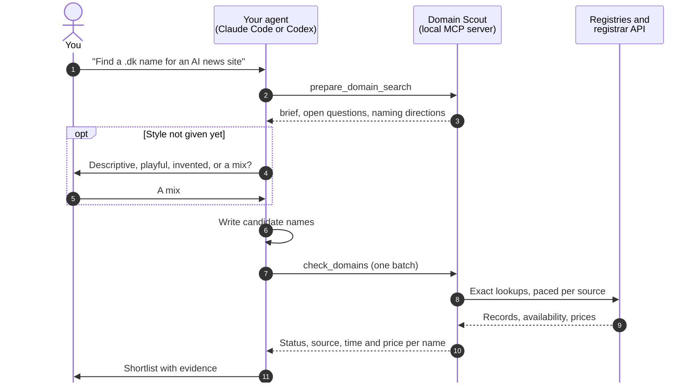

<p align="center">
  
</p>

# Domain Scout

Ask your coding agent for a domain name. It suggests names that fit your
project, looks each one up with the registry or a registrar, and tells you
which ones you can register, how certain that is, and the price when one is
quoted.

A plugin for **Claude Code** and **Codex**. It runs on your machine, needs no
API key, and requires Node.js 22 or newer.

## What it looks like

A real run from 24 October 2026, trimmed:

> **You:** Find a Danish domain for an AI news site. Prefer .dk, credible editorial tone.

| Domain | Why it fits | Punktum, the .dk registry |
| --- | --- | --- |
| aitidende.dk | *Tidende* is the classic Danish newspaper name | no record |
| aiposten.dk | The *-posten* ending reads as news | no record |
| aiudsyn.dk | *Udsyn* (outlook) suits analysis | no record |
| ainyt.dk, aiavisen.dk, dagensai.dk | | registered |

The agent wrote 40 names, checked them in two batches and rechecked its
shortlist before answering. "No record" means nobody holds the name; only a
registrar can confirm you can buy it. Results change, so check again before
you register.

## Install

**Claude Code**

```bash
claude plugin marketplace add ossianravn/domain-scout
claude plugin install domain-scout@domain-scout-local
```

Start a new session and ask for a name, or run `/domain-scout:find-domains`.

**Codex**

```bash
codex plugin marketplace add ossianravn/domain-scout
codex plugin add domain-scout@domain-scout-local
```

Start a new session and begin with "Use Domain Scout to…", or pick
`find-domains` from the skill list. In Codex, a plain naming request may not
trigger the skill.

To try a local copy without installing it, run
`claude --plugin-dir /path/to/domain-scout`. For Windows, WSL, credentials
and troubleshooting, see the [installation guide](docs/install.md).

## Things to ask

- "Find the shortest attractive domain for a short URL service."
- "Find a name for my second brain project. Explore metaphorical and invented names."
- "Find a domain for an app that helps teachers prepare lessons."
- "Find a Danish domain for an AI news site. Prefer .dk."
- "Check these exact domains and show registration and renewal prices: …"

If you haven't said what kind of name you want, the agent asks once, with
examples for your project: descriptive, suggestive, metaphorical, playful,
invented, a phrase across the dot, or a mix. It remembers your answer for the
rest of the conversation. Lists of exact domains are checked straight away.

## Reading the results

| Status | Meaning |
| --- | --- |
| `available` | The registry or registrar said it can be registered, at the time shown. |
| `not_found` | No registration record. Probably free, but not confirmed. |
| `registered` | Someone holds it. |
| `unavailable` | It can't be registered. The source didn't say why: taken, reserved or withheld. |
| `unknown` | The lookup failed, hit a rate limit or ran out of time. Ask again. |
| `unsupported` | No source covers this extension, for example `.es`. |
| `invalid` | Not a domain you can register: a URL, a subdomain or a bare extension. |

Every result keeps its source and check time. Prices keep their currency and
period; when a source gives no renewal period, it stays unknown. Domain Scout
doesn't buy domains, search resale listings or check trademarks.

## How it works



Your agent's own model writes the names, so there is no second model and no
key to set up. The server only looks up exact domains. The domain names you
check are the only thing it sends out; your project description stays with
your agent.

Both clients use the same skill and tools:

| Part | What it does |
| --- | --- |
| `find-domains` skill | Tells the agent how to ask, generate, check, rank and present |
| `prepare_domain_search` tool | Turns your request into a brief, questions and naming directions; lists short candidates from patterns such as `CVC` |
| `check_domains` tool | Looks up a batch of exact domains and returns status, evidence and prices |
| `domain_sources` tool | Shows which sources cover an extension, from a bundled catalog |

## Where the answers come from

| Extensions | Source | What it returns |
| --- | --- | --- |
| `.com`, `.io`, `.ai`, `.app`, `.dev` and the other extensions Vercel sells | Vercel Registrar API | Availability and prices |
| `.dk` | Punktum WHOIS | Registration records and waiting-list status |
| `.nl` | SIDN | Explicit "free" status |
| `.se`, `.nu` | Internetstiftelsen | Availability |
| `.is` | ISNIC | Availability |
| `.be` | DNS Belgium | Availability |
| `.ch`, `.li` | SWITCH | Availability |
| Other extensions with a published service | Registry RDAP, then WHOIS | Registration records |
| `.dk`, optional | Simply, with your API key | Registrar confirmation |
| Any, optional | A [Who-Dat](docs/who-dat.md) service you run | RDAP and WHOIS through your own proxy |

No source needs a key. Dedicated registry checks run before the general ones,
and a source that doesn't sell an extension can't mark it taken. For the full
routing order, see [sources](docs/providers.md); for the bundled IANA routing
data, see [catalog](docs/catalog.md).

**Speed.** Sources run in parallel, and repeat lookups within a minute come
from a cache. A call waits up to 10 seconds by default: names not finished by
then come back `unknown` and can be checked again. `.dk` and `.nl` answer
about one name per second, so large batches on those take longer.

## Settings

All optional. Set them in the environment that launches Claude Code or Codex;
`.env` files are not read.

| Variable | Default | Effect |
| --- | --- | --- |
| `DOMAIN_SCOUT_MAX_WAIT_MS` | 10000 | How long a check waits before returning what it has |
| `DOMAIN_SCOUT_TIMEOUT_MS` | 8000 | Timeout for each network request |
| `DOMAIN_SCOUT_CACHE_TTL_MS` | 60000 | How long results are reused; 0 turns the cache off |
| `DOMAIN_SCOUT_WHOIS_INTERVAL_MS` | 1000 | Spacing between WHOIS requests to the same server |
| `SIMPLY_API_KEY` or `SIMPLY_API_TOKEN` | unset | Adds Simply's registrar check for `.dk` |
| `DOMAIN_SCOUT_WHO_DAT_URL` | unset | Your Who-Dat service |
| `DOMAIN_SCOUT_WHO_DAT_TOKEN` | unset | Bearer token for that service |

## Command line

The same lookups work without an agent:

```bash
node dist/cli.cjs check '{"domains":["example.com","example.dk"],"fresh":true}'
node dist/cli.cjs prepare '{"project":"A second brain app","namingStyles":["mixed"]}'
node dist/cli.cjs sources '{"tlds":["dk","com","nl"]}'
```

Pass `-` or nothing to read the JSON from stdin.

## Development

```bash
npm ci
npm run check   # typecheck, build, offline tests
npm run smoke   # live lookups against public sources
```

`npm run build` regenerates `dist/` and the skill's copy of the CLI. Commit
them with your source changes, because Git installs run them as committed.
Keep source files under 300 lines. Run `npm run update:registry`, then build,
to embed newer IANA routing data.

## More

- [Installation guide](docs/install.md): Windows, WSL, credentials, updates, troubleshooting
- [Sources](docs/providers.md): routing order, limits and how each answer is read
- [Naming](docs/naming.md): directions and shortest-domain search
- [Catalog](docs/catalog.md): the bundled IANA routing data
- [Validation](docs/validation.md): what has been tested, and what hasn't

## License

[MIT](LICENSE). Bundled dependencies keep their own licenses; see
[third-party notices](THIRD_PARTY_NOTICES.md).
